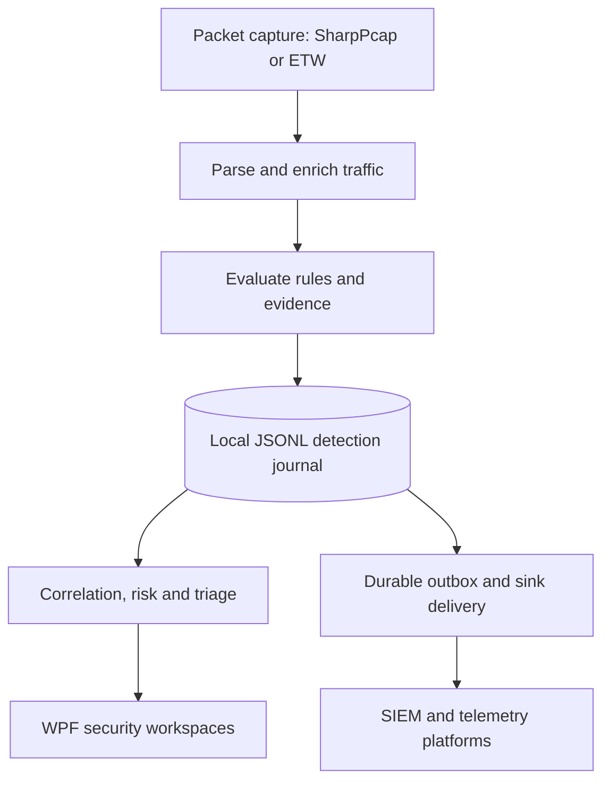

# Carthago

### Network Security Monitor

**Windows · C# · .NET 8 · WPF · Local-first security operations**

Carthago is a Windows desktop application for observing network traffic, detecting suspicious behavior, and turning security signals into evidence-led investigations. It combines live packet analysis, a configurable detection engine, local event journaling, incident correlation, and optional forwarding to security and observability platforms.

Built for security labs, detection engineering, and hands-on network operations, Carthago keeps the original evidence separate from dashboards, recommendations, and external integrations.

> **Project status:** Active development and experimentation. The repository includes a substantial detection catalog and newer security-operations foundations; the presence of a rule or module does not guarantee production validation, complete telemetry coverage, or a finished UI for every capability.


## Explore

- [Capabilities](#capabilities)
- [Architecture](#architecture)
- [Quick start](#quick-start)
- [Configuration](#configuration)
- [Detection engineering](#detection-engineering)
- [Integrations](#integrations)
- [Testing and demo](#testing-and-demo)
- [Security and limitations](#security-and-limitations)
- [Project layout and documentation](#project-layout-and-documentation)

## Capabilities

| Area | What Carthago provides |
| --- | --- |
| **Capture and visibility** | Windows network capture using SharpPcap or an ETW capture option; IPv4/IPv6, transport-layer, and selected DNS, HTTP, TLS, and QUIC metadata parsing. |
| **Detection engineering** | **544 built-in rule registrations (R001–R544)** covering reconnaissance, identity, lateral movement, DNS, TLS, web/API activity, exfiltration, IoT/OT, cloud and development tooling, and platform health. |
| **Context and enrichment** | Process association where available, service identification, WHOIS/RDAP, threat intelligence, reputation, and optional geolocation data. |
| **Evidence and investigations** | Durable JSONL detection journal, outbox, incident correlation, entity-risk context, investigation timelines, and analyst feedback foundations. |
| **Analyst experience** | WPF dashboards and workspaces for live traffic, alerts, anomalies, incidents, threat feeds, host integrity, integrations, and sink-delivery events. |
| **Interoperability** | Optional forwarding to OTLP, Azure Monitor, Splunk HEC, Elasticsearch, Kafka, CEF Syslog, GELF HTTP, JSONL files, and webhooks. |
| **Validation** | xUnit tests, deterministic rule/replay fixtures, a benchmark project, and rule-catalog precision/health checks. |

The catalog size describes registered rules, **not 544 guaranteed detections**. Rules depend on available telemetry, configuration, thresholds, and validation maturity. See the [rule registry](Carthago/Engine/Rules/Catalog/RuleRegistry.cs) and [detection engineering model](Carthago/docs/DetectionEngineeringModel.md).

## Architecture



The **local detection journal is the authoritative record**. UI views, incidents, risk scores, summaries, exports, and sink deliveries are derived from detection evidence; they must not replace or silently discard the original events. This design makes replay, review, and fault investigation possible even when an external destination is unavailable.

Key implementation entry points:

| Concern | Source |
| --- | --- |
| Capture orchestration | [`TrafficCaptureService`](Carthago/Services/TrafficCaptureService.cs) |
| Packet parsing | [`PacketHandler`](Carthago/Services/PacketHandler.cs) |
| Rule registration | [`RuleRegistry`](Carthago/Engine/Rules/Catalog/RuleRegistry.cs) |
| Rule evaluation | [`RuleEngine`](Carthago/Engine/RuleEngine.Core.cs) |
| Durable evidence | [`DetectionJournal`](Carthago/Services/Journaling/DetectionJournal.cs) and [`DetectionOutbox`](Carthago/Services/Journaling/DetectionOutbox.cs) |
| Incident correlation | [`IncidentCorrelationEngine`](Carthago/Analytics/Services/IncidentCorrelationEngine.cs) |
| External delivery | [`SinkManager`](Carthago/Sinks/SinkManager.cs) |

## Quick start

### Requirements

- **Windows 10/11** with a desktop session. WPF is Windows-specific.
- **.NET 8 SDK** (Visual Studio with .NET desktop development is optional).
- A supported capture source. **SharpPcap** generally uses an installed packet-capture driver such as Npcap on Windows; the application also exposes an **ETW capture option that does not require Npcap**.
- Appropriate local permissions for the chosen capture source. Some capture configurations require elevation.

### Clone, build, test and launch

Open **PowerShell** on Windows:

```powershell
git clone https://github.com/afiay/Carthago-Network-Security-Monitor.git
Set-Location Carthago-Network-Security-Monitor

dotnet restore DOTNET.sln
dotnet build DOTNET.sln --no-restore
dotnet test DOTNET.sln --no-build
dotnet run --project Carthago/Carthago.csproj
```

In the application, choose a capture device or the available ETW source, then start capture. Begin with a controlled test network and verify incoming records before enabling detection forwarding.

The repository also provides [`scripts/ci-build.ps1`](scripts/ci-build.ps1) and [`scripts/ci-test.ps1`](scripts/ci-test.ps1) for the solution-level build and test workflow.

## Configuration

| File or setting | Purpose | Source control |
| --- | --- | --- |
| [`Carthago/rules.json`](Carthago/rules.json) | Rule enablement, thresholds, overrides, and profiles. | Tracked default configuration |
| [`environment-tuning.sample.json`](environment-tuning.sample.json) | Example approved DNS, admin, cloud, IoT/OT, and other environment assets. | Tracked sample only |
| `environment-tuning.json` | Optional environment-specific copy of the sample. | **Keep local** |
| `Carthago/.env` or an environment variable | Optional `ABUSEIPDB_API_KEY` for reputation lookups. | **Never commit** |
| Application preferences | UI, sensitivity, and sink configuration, persisted locally. | **Never commit secrets or runtime preferences** |

If you want AbuseIPDB enrichment, provide the key locally or through your environment. For example, in a local `.env` file:

```dotenv
ABUSEIPDB_API_KEY=replace_with_your_own_key
```

The application can run without this key; it warns that AbuseIPDB lookups are unavailable. Other external integrations may require their own credentials, endpoints, and network access.

Configuration and generated runtime state are described in [Runtime Data](docs/runtime-data.md). Local journals, outboxes, feedback, baselines, packet captures, and generated reports should not be committed.

## Detection engineering

The built-in catalog spans IDs **R001–R544**. Examples of covered signal families include:

- **Network behavior:** scanning, service exposure, lateral-movement patterns, novel destinations, and abnormal traffic volumes.
- **Identity and web:** unusual authentication behavior, credential exposure indicators, suspicious HTTP/API requests, and TLS anomalies.
- **DNS and communications:** tunneling heuristics, beaconing patterns, DNS anomalies, and suspicious external services.
- **Infrastructure:** cloud/dev workflows, Kubernetes/container signals, IoT/OT protocols, and sensor or pipeline health.
- **Data movement:** unusual uploads, exfiltration candidates, and evasive network behavior.

Each rule is modeled as a detection-engineering asset with metadata, telemetry requirements, evidence fields, confidence or precision considerations, and investigation guidance. Catalog coverage and maturity are separate questions; detections should be tuned and replay-tested against known benign and malicious examples before deployment.

Start with:

- [Detection engineering model](Carthago/docs/DetectionEngineeringModel.md)
- [Rule precision profiles](Carthago/docs/RulePrecisionProfiles.md)
- [Rule expansion R123–R272](Carthago/docs/R123_R272_SelectedRules.md)
- [Rule expansion R273–R544](Carthago/docs/R273_R544_SelectedRules.md)
- [Adding detection rules](Carthago/docs/AddingDetectionRules.md)

### Investigation and guarded assistance

Incident correlation, entity scoring, analyst feedback, and investigation context build on preserved journal evidence. The current [`LocalInvestigationCopilot`](Carthago/Services/InvestigationCopilot/LocalInvestigationCopilot.cs) provides **bounded, evidence-linked summaries** from supplied local facts; it is not a general-purpose conversational model and does not autonomously isolate or block endpoints.

The v6 foundation also contains interfaces and models for response playbooks, sensors, content packs, hunting, and automation. **Full enforcement adapters, cloud fleet management, and some richer UI capabilities remain future work**, as noted in the [v6 vision](Carthago/docs/CarthagoV6Vision.md).

## Integrations

Optional detection destinations live in [`Carthago/Sinks`](Carthago/Sinks):

| Destination | Interface |
| --- | --- |
| OpenTelemetry | OTLP |
| Azure Monitor | Logs ingestion via DCR/DCE |
| Splunk | HTTP Event Collector (HEC) |
| Elasticsearch | Bulk ingestion |
| Kafka | Event producer |
| Syslog | CEF over TCP/TLS |
| Graylog-compatible services | GELF HTTP |
| Local storage | JSONL file sink |
| Custom systems | JSON webhook |

Sink delivery is handled through a fan-out manager with bounded queues, batching, retry/backoff, and delivery telemetry. Configure destinations in **Integrations** and inspect attempts in **Sink Events**. Review endpoint trust, access control, and data sensitivity before exporting observations from your network.

## Testing and demo

The solution includes unit and integration-oriented tests under [`Carthago.Tests`](Carthago.Tests), a separate [rule-architecture test harness](Carthago/Tests), and replay samples under [`Tests/RuleReplaySamples`](Tests/RuleReplaySamples).

Run tests:

```powershell
dotnet test DOTNET.sln
```

Run the replay benchmark (after restoring dependencies):

```powershell
.\scripts\run-replay-benchmark.ps1
```

The [demo scenario](docs/demo-scenario.md) walks through an evolving suspicious host, correlated detections, incident evidence, and analyst feedback. See [Replay Testing](Carthago/docs/ReplayTesting.md) for sample expectations.

These commands describe the intended Windows workflow; **this README update does not claim a fresh successful build, test run, or production certification**.

## Security and limitations

- **Authorization and privacy:** capture only traffic you are authorized to inspect. Packets, hostnames, process metadata, journals, and exports may contain sensitive information.
- **Credentials:** use environment variables or local secret storage; do not check in `.env`, access tokens, sink credentials, or runtime preferences. Rotate credentials if they have ever appeared in a public repository.
- **Evidence boundaries:** the JSONL journal is the source of truth. Derived incident views, local summaries, and sink deliveries must not be treated as replacements for raw evidence.
- **Detection accuracy:** rules are heuristic or telemetry-dependent and can produce false positives or miss activity. Establish environment baselines and review precision profiles before relying on alerts.
- **Controlled response:** containment recommendations are not automatic authorization to execute disruptive actions. Response integrations require deliberate review and safeguards.
- **Platform scope:** this is a Windows desktop project. Current v6 foundations do not imply a production-ready, managed multi-sensor SaaS platform.

For the documented architectural constraints, read [Architecture Safety Rules](Carthago/docs/ArchitectureSafetyRules.md).

## Project layout and documentation

```text
Carthago/               WPF application, capture, detection engine, services, and sinks
Carthago.Tests/         xUnit test suite
Carthago.Benchmarks/    Replay and benchmarking console project
Carthago/Tests/         Additional rule-architecture test harness
Tests/                  Replay and other testing fixtures
config/samples/         Example content-pack configurations
docs/                   Demo, UI, runtime, and integration documentation
Carthago/docs/          Detection engineering and v6 architecture guides
scripts/                Build, test, and replay benchmark scripts
DOTNET.sln              Solution entry point
```

Useful starting points:

- [Architecture and safety](Carthago/docs/ArchitectureSafetyRules.md)
- [Content packs](Carthago/docs/ContentPacks.md) · [pack examples](docs/ContentPacks/README.md)
- [Investigation copilot](Carthago/docs/InvestigationCopilot.md) · [response playbooks](Carthago/docs/ResponsePlaybooks.md)
- [Runtime data and persistence](docs/runtime-data.md)
- [Demo and analyst walkthrough](docs/demo-scenario.md)

## License

Distributed under the [MIT License](LICENSE).
