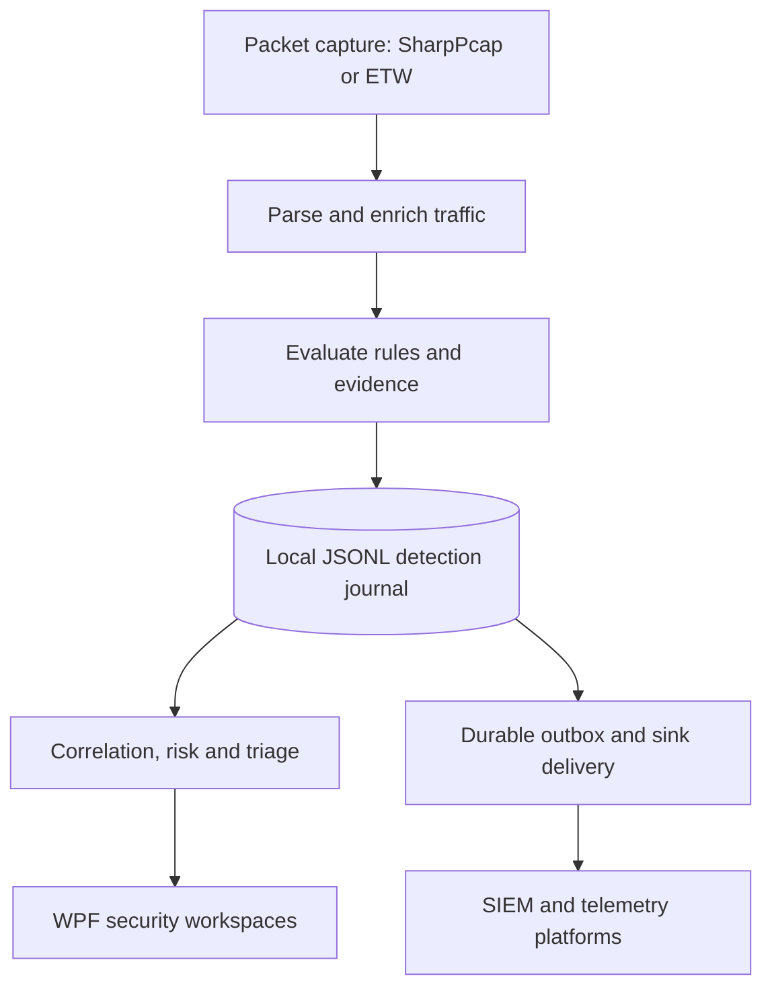

# Carthago — Network Security Monitor

**Local-first network detection, security operations and evidence-led investigations.**

[](docs/CURRENT_STATUS.md)
[](Carthago/Carthago.csproj)
[](Carthago/Carthago.csproj)
[](Carthago.Cli/Carthago.Cli.csproj)
[](Carthago/Carthago.csproj)
[](docs/03-detection-rules/MASTER_RULE_CATALOG.md)
[](.github/workflows/carthago-detection-quality.yml)
[](LICENSE)

Carthago combines a **Windows WPF monitoring desktop**, a **portable .NET CLI**, a growing rule registry, local evidence journals, investigation workspaces and optional SIEM destinations. The desktop performs capture and detection; the CLI also supports bounded portable capture/replay for an explicitly supported rule subset.

> **Development build — not a production release.** The badges show checked-in versions and targets, not live CI results or certification. **1000 registered IDs does not mean 1000 qualified detections.** See [current verification, tested SHAs and pending release gates](docs/CURRENT_STATUS.md).

**Documentation:** [Overview](docs/README.md) · [Rule catalog](docs/03-detection-rules/MASTER_RULE_CATALOG.md) · [Architecture](docs/02-architecture/README.md) · [Operations](docs/08-operations/README.md)


## Contents

- [Versions, platforms and status flags](#versions-platforms-and-status-flags)
- [Capabilities](#capabilities)
- [Quick start](#quick-start)
- [CLI options and flags](#cli-options-and-flags)
- [Architecture](#architecture)
- [Configuration](#configuration)
- [Detection engineering](#detection-engineering)
- [Integrations](#integrations)
- [Testing and demo](#testing-and-demo)
- [Security and limitations](#security-and-limitations)
- [Project layout and documentation](#project-layout-and-documentation)
- [License](#license)


## Versions, platforms and status flags

These values come from checked-in project files on the working branch. The **WPF desktop has no explicitly declared product version**; the illustrative minimum `0.1.0` in `VersionHealthService` is a health baseline, **not** a published desktop release. Do not equate it to the separately versioned CLI.

| Component | Version or target | Supported scope / status |
| --- | --- | --- |
| **Desktop (WPF)** | `net8.0-windows10.0.19041.0`; **release version not declared** | Windows desktop; project declares `win-x64` and `win-arm64` runtime targets, but runtime targets alone do not prove both architectures were tested |
| **CLI** | **v0.1.0**, `net8.0` | Windows and Linux CLI tested in bounded historical runs; portable detection currently supports an explicit subset |
| **Windows monitor service** | `net8.0-windows10.0.19041.0`; no separate product version | Source candidate; native SCM recovery and unattended acceptance pending |
| **Capture library** | SharpPcap **6.3.1** | Windows packet-driver capture; separate ETW option where available |
| **Test framework** | xUnit **2.5.3** | Test outcomes must be attributed to a particular checkout SHA and evidence |
| **Detection registry** | **1000** registered R001–R1000 | Not a count of independently positive/negative-qualified rules |
| **CI** | **Manual** GitHub Actions profiles | Owner-authorized workflow dispatch; no automatic green build badge |
| **License** | MIT | [License file](LICENSE) |

**Status flag glossary:** **Implemented** means code is present; **Synthetic PASS** means a bounded test passed at a recorded SHA; **Pending** means an identified evidence or deployment gate remains open; **Field-qualified** and **Release-approved** require their own proof and must not be inferred from badges.

The Windows target `10.0.19041.0` is a project API baseline. The in-app health checker recommends Windows build **10.0.19044** or later; that recommendation is separate from the target framework. All current project targets above are **.NET 8** even if a newer SDK is installed.


## Capabilities

| Area | What Carthago provides |
| --- | --- |
| **Capture and visibility** | Windows network capture using SharpPcap or an ETW capture option; IPv4/IPv6, transport-layer, and selected DNS, HTTP, TLS, and QUIC metadata parsing. |
| **Detection engineering** | An expanding R-series rule catalog covering reconnaissance, identity, lateral movement, DNS, TLS, web/API activity, exfiltration, IoT/OT, cloud and development tooling, and platform health. The current source registry has 1000 R-series IDs; exact rule qualification is incomplete. |
| **Context and enrichment** | Process association where available, service identification, WHOIS/RDAP, threat intelligence, reputation, and optional geolocation data. |
| **Evidence and investigations** | Durable JSONL detection journal, outbox, incident correlation, entity-risk context, investigation timelines, and analyst feedback foundations. |
| **Analyst experience** | WPF dashboards and workspaces for live traffic, alerts, anomalies, incidents, threat feeds, host integrity, integrations, and sink-delivery events. |
| **Interoperability** | Optional forwarding to OTLP, Azure Monitor, Splunk HEC, Elasticsearch, Kafka, CEF Syslog, GELF HTTP, JSONL files, and webhooks. |
| **Validation** | xUnit tests, deterministic rule/replay fixtures, a benchmark project, and rule-catalog precision/health checks. |

The catalog describes **registered rules, not guaranteed detections**. Rules depend on available telemetry, configuration, thresholds, and validation maturity. See the [rule registry](Carthago/Engine/Rules/Catalog/RuleRegistry.cs) and [detection engineering model](docs/03-detection-rules/guides/DetectionEngineeringModel.md).

## Quick start

### Requirements

- **Windows 10/11** with a desktop session. WPF is Windows-specific.
- **.NET 8 SDK** (Visual Studio with .NET desktop development is optional).
- A supported capture source. **SharpPcap** generally uses an installed packet-capture driver such as Npcap on Windows; the application also exposes an **ETW capture option that does not require Npcap**.
- Appropriate local permissions for the chosen capture source. Some capture configurations require elevation.

### Clone, build, test and launch

Open **PowerShell** on Windows:

```powershell
git clone --branch feature/carthago-reliability-hardening https://github.com/afiay/Carthago-Network-Security-Monitor.git
Set-Location Carthago-Network-Security-Monitor

dotnet --version
dotnet restore DOTNET.sln
dotnet build DOTNET.sln -c Release --no-restore
dotnet run --project Carthago/Carthago.csproj -c Release
```

In the application, choose a capture device or the available ETW source, then start capture. Begin with a controlled test network and verify incoming records before enabling detection forwarding.

The repository also provides [`scripts/ci-build.ps1`](scripts/ci-build.ps1) and [`scripts/ci-test.ps1`](scripts/ci-test.ps1) for the solution-level build and test workflow.

### Portable CLI on Windows or Linux

The CLI is a separate `net8.0` executable. These commands are read-only and **do not launch live monitoring**:

```bash
dotnet restore Carthago.Cli/Carthago.Cli.csproj
dotnet run --project Carthago.Cli/Carthago.Cli.csproj -c Release -- --version --json
dotnet run --project Carthago.Cli/Carthago.Cli.csproj -c Release -- capabilities --json
dotnet run --project Carthago.Cli/Carthago.Cli.csproj -c Release -- rules capabilities --portable --json
dotnet run --project Carthago.Cli/Carthago.Cli.csproj -c Release -- capture doctor --json
```

The `--version` result is the **CLI v0.1.0** version, not a global desktop or service release version. Linux CLI regression and bounded WSL2 capture/replay evidence exist, but Linux unattended service hosting remains unqualified.


## CLI options and flags

The following command shapes are defined by [`CliApplication.cs`](Carthago.Cli/CliApplication.cs). Flags must be passed in the documented position; **`--json` must be last**.

| Option or command | Effect | Boundary |
| --- | --- | --- |
| `--help` | Show commands and syntax | Read-only |
| `--version [--json]` | Report the CLI version (**v0.1.0**) | Does not version the desktop |
| `--json` | Structured response for supported commands | Final argument |
| `rules capabilities --portable` | Show supported portable detectors | Not the full 1000-ID Windows registry |
| `capture doctor --json` | Inspect capture prerequisites | Not a live capture test |
| `capture interfaces --json` | Enumerate interfaces | Discovery, not authorization |
| `pcap inspect <file.pcap|file.pcapng>` | Read existing capture metadata | Imported evidence remains untrusted |
| `pcap detect <file> --rules R586[,R...]` | Offline replay with selected portable rules | Rule IDs must be supported |
| `capture qualify --interface ID --seconds 1-60 --authorized-test-time` | Bounded live capture qualification | Requires specific owner authorization and capture privileges |
| `monitor run --interface ID --rules R586[,R...] --authorized-test-time` | Foreground capture and portable detection | Explicit authorization; not an installed service |
| `monitor journal <session-directory> --json` | Inspect a locally recorded monitor session | Inspection is not proof of event authenticity |
| `service status|health|start|stop|doctor` | Windows service management | Service deployment acceptance still pending |

See [CLI implementation](docs/07-design/roadmap/CARTHAGO_CLI_IMPLEMENTATION.md) and [current qualification gates](docs/CURRENT_STATUS.md) before performing capture or service operations.


## Architecture



The **local detection journal is the authoritative Windows detection record**; the portable monitor also has its own explicitly scoped session journal. UI views, incidents, risk scores, summaries, exports, and sink deliveries are derived from detection evidence; they must not replace or silently discard the original events. This design makes replay, review, and fault investigation possible even when an external destination is unavailable.

Key implementation entry points:

| Concern | Source |
| --- | --- |
| Capture orchestration | [`TrafficCaptureService`](Carthago/Services/TrafficCaptureService.cs) |
| Packet parsing | [`PacketHandler`](Carthago/Services/PacketHandler.cs) |
| Rule registration | [`RuleRegistry`](Carthago/Engine/Rules/Catalog/RuleRegistry.cs) |
| Rule evaluation | [`RuleEngine`](Carthago/Engine/RuleEngine.Core.cs) |
| Durable evidence | [`DetectionJournal`](Carthago/Services/Journaling/DetectionJournal.cs) and [`DetectionOutbox`](Carthago/Services/Journaling/DetectionOutbox.cs) |
| Incident correlation | [`IncidentCorrelationEngine`](Carthago/Analytics/Services/IncidentCorrelationEngine.cs) |
| External delivery | [`SinkManager`](Carthago/Sinks/SinkManager.cs) |

## Configuration

| File or setting | Purpose | Source control |
| --- | --- | --- |
| [`Carthago/rules.json`](Carthago/rules.json) | Rule enablement, thresholds, overrides, and profiles. | Tracked default configuration |
| [`environment-tuning.sample.json`](environment-tuning.sample.json) | Example approved DNS, admin, cloud, IoT/OT, and other environment assets. | Tracked sample only |
| `environment-tuning.json` | Optional environment-specific copy of the sample. | **Keep local** |
| `Carthago/.env` or an environment variable | Optional `ABUSEIPDB_API_KEY` for reputation lookups. | **Never commit** |
| Application preferences | UI, sensitivity, and sink configuration, persisted locally. | **Never commit secrets or runtime preferences** |

If you want AbuseIPDB enrichment, provide the key locally or through your environment. For example, in a local `.env` file:

```dotenv
ABUSEIPDB_API_KEY=replace_with_your_own_key
```

The application can run without this key; it warns that AbuseIPDB lookups are unavailable. Other external integrations may require their own credentials, endpoints, and network access.

Configuration and generated runtime state are described in [Runtime Data](docs/08-operations/runtime-data.md). Local journals, outboxes, feedback, baselines, packet captures, and generated reports should not be committed.

## Detection engineering

The built-in catalog registers **1000 IDs (R001–R1000)**, but the independently qualified positive/negative coverage is not yet established for all of them. Examples of covered signal families include:

- **Network behavior:** scanning, service exposure, lateral-movement patterns, novel destinations, and abnormal traffic volumes.
- **Identity and web:** unusual authentication behavior, credential exposure indicators, suspicious HTTP/API requests, and TLS anomalies.
- **DNS and communications:** tunneling heuristics, beaconing patterns, DNS anomalies, and suspicious external services.
- **Infrastructure:** cloud/dev workflows, Kubernetes/container signals, IoT/OT protocols, and sensor or pipeline health.
- **Data movement:** unusual uploads, exfiltration candidates, and evasive network behavior.

Each rule is modeled as a detection-engineering asset with metadata, telemetry requirements, evidence fields, confidence or precision considerations, and investigation guidance. Catalog coverage and maturity are separate questions; detections should be tuned and replay-tested against known benign and malicious examples before deployment.

Start with:

- [Detection engineering model](docs/03-detection-rules/guides/DetectionEngineeringModel.md)
- [Rule precision profiles](docs/03-detection-rules/guides/RulePrecisionProfiles.md)
- [Rule expansion R123–R272](docs/03-detection-rules/guides/R123_R272_SelectedRules.md)
- [Rule expansion R273–R544](docs/03-detection-rules/guides/R273_R544_SelectedRules.md)
- [Adding detection rules](docs/03-detection-rules/guides/AddingDetectionRules.md)

### Investigation and guarded assistance

Incident correlation, entity scoring, analyst feedback, and investigation context build on preserved journal evidence. The current [`LocalInvestigationCopilot`](Carthago/Services/InvestigationCopilot/LocalInvestigationCopilot.cs) provides **bounded, evidence-linked summaries** from supplied local facts; it is not a general-purpose conversational model and does not autonomously isolate or block endpoints.

The v6 foundation also contains interfaces and models for response playbooks, sensors, content packs, hunting, and automation. **Full enforcement adapters, cloud fleet management, and some richer UI capabilities remain future work**, as noted in the [v6 vision](docs/02-architecture/CarthagoV6Vision.md).

**Current evidence:** [Exact registry reconciliation](docs/05-detection-quality/REGISTRY_RECONCILIATION_20261116.md) · [Exact-ID audit](docs/05-detection-quality/EXACT_ID_QUALIFICATION_AUDIT.md) · [Current overall status](docs/CURRENT_STATUS.md). The portable synthetic replay matrix covers R586–R605 specifically; it is not a certificate for all R-series IDs.

## Integrations

Optional detection destinations live in [`Carthago/Sinks`](Carthago/Sinks):

| Destination | Interface |
| --- | --- |
| OpenTelemetry | OTLP |
| Azure Monitor | Logs ingestion via DCR/DCE |
| Splunk | HTTP Event Collector (HEC) |
| Elasticsearch | Bulk ingestion |
| Kafka | Event producer |
| Syslog | CEF over TCP/TLS |
| Graylog-compatible services | GELF HTTP |
| Local storage | JSONL file sink |
| Custom systems | JSON webhook |

Sink delivery is handled through a fan-out manager with bounded queues, batching, retry/backoff, and delivery telemetry. Configure destinations in **Integrations** and inspect attempts in **Sink Events**. Review endpoint trust, access control, and data sensitivity before exporting observations from your network.

## Testing and demo

The solution includes unit and integration-oriented tests under [`Carthago.Tests`](Carthago.Tests), a separate [rule-architecture test harness](Carthago/Tests), and replay samples under [`Tests/RuleReplaySamples`](Tests/RuleReplaySamples).

Run the primary Windows test project **only in an authorized test session**:

```powershell
dotnet test Carthago.Tests/Carthago.Tests.csproj -c Release
```

Run the replay benchmark (after restoring dependencies):

```powershell
.\scripts\run-replay-benchmark.ps1
```

The [demo scenario](docs/01-getting-started/demo-scenario.md) walks through an evolving suspicious host, correlated detections, incident evidence, and analyst feedback. See [Replay Testing](docs/05-detection-quality/guides/ReplayTesting.md) for sample expectations.

### Documentation-only quality checks

```powershell
python scripts/build_docs_index.py --check
python scripts/check_docs_links.py
python scripts/check_docs_status.py
python scripts/check_readme_metadata.py
```

**Recorded, not re-run here:** a historical Windows full xUnit 14,361/14,361 PASS, portable paired replay R586–R605 on both platforms, and bounded active-sensor tests. The original full-suite TRX still lacks strict contemporaneous execution-SHA artifact linkage; source- and artifact-qualified gates are documented separately. R102 V1 historically FAILED 4/6, V2 remains 0/4 approved external R102 pairs, and DNS wire Stages 2–4 remain compiler-guarded. **Neither this README update nor a static badge is new verification.** [Evidence matrix](docs/CURRENT_STATUS.md).

The centralized GitHub Actions validation workflow is [manual and owner-gated](.github/workflows/carthago-detection-quality.yml); a CI-passing badge would be misleading.

## Security and limitations

- **Authorization and privacy:** capture only traffic you are authorized to inspect. Packets, hostnames, process metadata, journals, and exports may contain sensitive information.
- **Credentials:** use environment variables or local secret storage; do not check in `.env`, access tokens, sink credentials, or runtime preferences. Rotate credentials if they have ever appeared in a public repository.
- **Evidence boundaries:** the JSONL journal is the source of truth. Derived incident views, local summaries, and sink deliveries must not be treated as replacements for raw evidence.
- **Detection accuracy:** rules are heuristic or telemetry-dependent and can produce false positives or miss activity. Establish environment baselines and review precision profiles before relying on alerts.
- **Controlled response:** containment recommendations are not automatic authorization to execute disruptive actions. Response integrations require deliberate review and safeguards.
- **Platform scope:** WPF remains Windows-specific, while the separate `net8.0` CLI has bounded Windows/Linux qualification. A cross-platform CLI does not mean Linux GUI or daemon production support. Current v6 foundations do not imply a production-ready, managed multi-sensor SaaS platform.

For the documented architectural constraints, read [Architecture Safety Rules](docs/02-architecture/ArchitectureSafetyRules.md).
- **Current release gates:** Windows SCM recovery, Linux L8C unattended service hosting, full UI visual/operational acceptance, field detection accuracy and individually reconciled rule tests remain open. [Current status](docs/CURRENT_STATUS.md).

## Project layout and documentation

```text
Carthago/               WPF application, capture, detection engine, services, and sinks
Carthago.Contracts/     Shared .NET 8 contracts
Carthago.Core/          Portable .NET 8 detection/session components
Carthago.Cli/           Versioned CLI (v0.1.0)
Carthago.Cli.Tests/     Portable CLI xUnit suite
Carthago.Monitor/       Windows monitor-service candidate
Carthago.ActiveQualification/  Active-sensor qualification harness
Carthago.Tests/         Main Windows xUnit test suite
Carthago.Benchmarks/    Replay and benchmarking console project
Carthago/Tests/         Additional rule-architecture test harness
Tests/                  Replay and other testing fixtures
config/samples/         Example content-pack configurations
docs/README.md          Complete categorized documentation navigation
docs/CURRENT_STATUS.md  Evidence-linked status and outstanding gates
docs/01-*/ ... 10-*/    Getting started through reference, organized by topic
docs/archive/           Historical UI implementation notes
docs/rules/, docs/design/  Path-stable work contracts and current progress ledgers
scripts/                Build, test, and replay benchmark scripts
DOTNET.sln              Solution entry point
```

Useful starting points:

- [All documentation](docs/README.md) · [current status](docs/CURRENT_STATUS.md) · [legacy path map](docs/10-reference/LEGACY_DOCUMENTATION_PATHS.md)
- [Architecture and safety](docs/02-architecture/ArchitectureSafetyRules.md)
- [Content packs](docs/03-detection-rules/guides/ContentPacks.md) · [pack examples](docs/03-detection-rules/content-packs/README.md)
- [Investigation copilot](docs/08-operations/guides/InvestigationCopilot.md) · [response playbooks](docs/08-operations/guides/ResponsePlaybooks.md)
- [Runtime data and persistence](docs/08-operations/runtime-data.md)
- [Demo and analyst walkthrough](docs/01-getting-started/demo-scenario.md)

## License

Distributed under the [MIT License](LICENSE).
